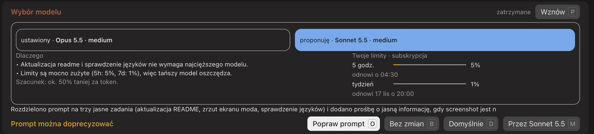
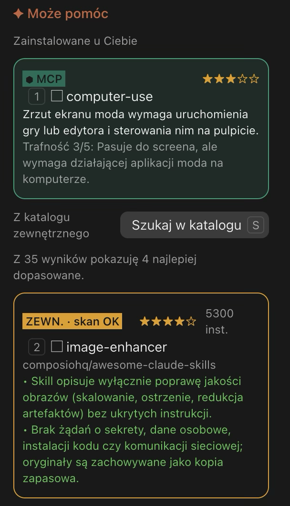

# Skill Router

A Claude Code mod that looks at your prompt **before** it is sent and shows what the task needs:

- **Installed skills and MCP connectors** that fit the task, each with a one-line reason and a 1–5 star relevance rating. Items the prompt names directly are pre-selected.
- **A model suggestion** (for example Haiku or Sonnet for simpler work) with a short rationale, a rough cost estimate and your current plan limits.
- **External skills** from the public skills catalog, searched on demand or automatically. Each candidate is scanned before you can use it. Nothing is installed.
- **Prompt improvement.** When the prompt is vague, the mod offers a clearer version with a short explanation. You decide whether to send the original or the improved text.

Selected skills and connectors are added as context only for the message you send. Nothing is installed without your consent.





The screenshots show the Polish interface; the English one has the same layout.

Polish version: [README.pl.md](README.pl.md)

## How it works

After you press Enter, a short countdown starts. Inside it you can:

| Action | Key | What happens |
| --- | --- | --- |
| Send as is | `b` | Sends your prompt; only tools you named directly stay selected |
| Send with defaults | `d` | Sends with the tools you selected |
| Use the suggested model | `m` | Switches the session model to the suggested one |
| Improve the prompt | `o` | Opens a before/after view above the input |
| Skills panel | `s` | Opens the side panel when it did not open by itself, e.g. to search the catalog |
| Pause / resume | `p` | Stops or restarts the countdown |

When the countdown runs out, the prompt is sent as is (`b`). The timing defaults are 15 s for the model decision, 15 s plus 5 s per suggestion otherwise, and +10 s when a prompt improvement is offered.

In the improvement view: `x` rejects, `a` accepts the improved text, and `w` accepts it and sends it with the suggested model.

The side panel opens only when it has something to choose: skill or MCP suggestions, or catalog search results. When only the model choice or a prompt improvement is on offer, everything stays in the bar above the input. Press `s` to open the panel by hand, for example to search the catalog.

## Language

The mod speaks Polish and English. By default (`auto`) it follows the language of each prompt: write in Polish and the bar, the panel and the explanations are in Polish; write in English and they are in English. For a prompt in another language, the explanations from the models follow that language and the interface falls back to your system language, then to English. The improved prompt always keeps the language you wrote in.

Set it by hand with `/router lang pl`, `/router lang en` or back to `/router lang auto`. The language of the Claude app does not matter: the mod draws its own text.

Another language is one more dictionary in `hooks/i18n.ts` with the same keys.

## Commands

- `/router on|off` – enable or disable the mod
- `/router time <base> <per suggestion>` – countdown in seconds (`czas` works too)
- `/router auto on|off` – automatic catalog search when a task needs an external tool
- `/router stack <technologies>` – your stack, e.g. `Next.js, Supabase`, used when ranking suggestions
- `/router lang pl|en|auto` – interface language; `auto` follows each prompt

## Requirements

- Claude Code with mod (plugin hooks) support.
- Node.js with `npx` on the PATH, for catalog search (`npx skills find`).

## Installation

In a Claude Code session:

```bash
/plugin install skill-router --marketplace chudy34/skill-router
```

Or from the shell:

```bash
claude plugin marketplace add chudy34/skill-router
claude plugin install skill-router@skill-router
```

The repository is public, so installing it does not require GitHub access.

To update:

```bash
claude plugin marketplace update skill-router
claude plugin update skill-router@skill-router
```

## Privacy and cost

- Routing runs on Haiku on every prompt. Prompt improvement runs on Sonnet only when the prompt is judged vague, or when you press `o`.
- Catalog search sends short English keywords derived from your prompt to the skills index through `npx`. Your full prompt is not sent there.
- Downloaded `SKILL.md` files are read and audited locally and by a model before they can be used.

## Development

```bash
claude plugin test .
claude plugin validate .
```

## License

Released under the MIT License. See [LICENSE](LICENSE).
