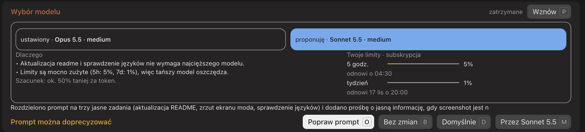
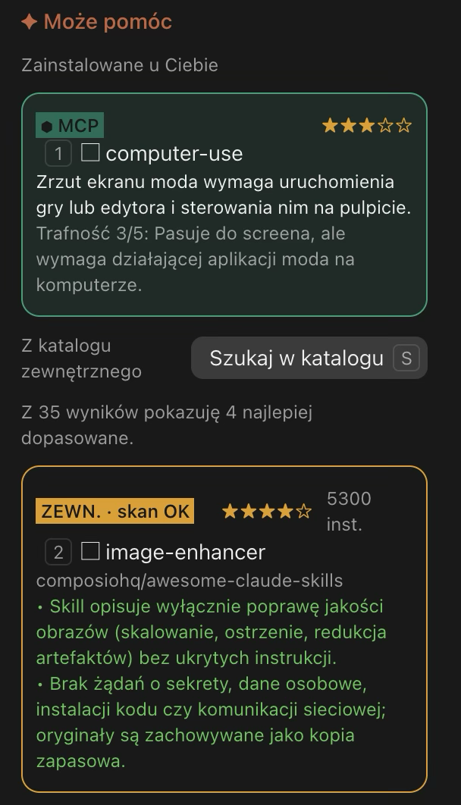

# Skill Router

Mod do Claude Code. Zanim prompt zostanie wysłany, sprawdza, czego zadanie potrzebuje, i pokazuje:

- **zainstalowane skille i konektory MCP**, które pasują do zadania, z jednym zdaniem uzasadnienia i oceną trafności 1–5 gwiazdek. Narzędzia nazwane wprost w prompcie są zaznaczone od razu.
- **propozycję modelu** (np. Haiku lub Sonnet do prostszych zadań) z krótkim uzasadnieniem, szacunkiem kosztu i Twoimi limitami planu.
- **zewnętrzne skille** z publicznego katalogu, wyszukiwane na żądanie albo automatycznie. Każdy kandydat jest skanowany przed użyciem. Nic nie jest instalowane.
- **poprawę promptu.** Gdy prompt jest niejasny, mod proponuje wersję doprecyzowaną z krótkim wyjaśnieniem. Ty decydujesz, czy wysłać oryginał, czy poprawiony tekst.

Wybrane skille i konektory trafiają do modelu jako kontekst tylko do wiadomości, którą wysyłasz. Nic nie jest instalowane bez Twojej zgody.





English version: [README.md](README.md)

## Jak to działa

Po naciśnięciu Enter rusza krótkie odliczanie. W jego trakcie możesz:

| Akcja | Klawisz | Co się dzieje |
| --- | --- | --- |
| Wyślij bez zmian | `b` | Wysyła prompt; zostają tylko narzędzia, które wskazałeś wprost |
| Wyślij z domyślnymi | `d` | Wysyła z narzędziami, które zaznaczyłeś |
| Użyj proponowanego modelu | `m` | Przełącza model sesji na proponowany |
| Popraw prompt | `o` | Otwiera widok przed/po nad polem wpisywania |
| Skille | `s` | Otwiera panel boczny, gdy nie otworzył się sam, np. żeby szukać w katalogu |
| Pauza / wznów | `p` | Zatrzymuje lub wznawia odliczanie |
| Ustawienia | `u` | Otwiera panel ustawień (przycisk ⚙) |

Po upływie czasu prompt idzie bez zmian (jak `b`). Domyślne czasy: 15 s na decyzję o modelu, 15 s plus 5 s za każdą propozycję w pozostałych przypadkach, a przy proponowanej poprawie dodatkowe 10 s.

W widoku poprawy: `x` odrzuca, `a` przyjmuje poprawiony tekst, a `w` przyjmuje go i wysyła z proponowanym modelem.

Panel boczny otwiera się tylko wtedy, gdy jest w nim coś do wyboru: propozycje skilli lub MCP albo wyniki z katalogu. Gdy w grę wchodzi tylko wybór modelu albo poprawa promptu, wszystko zostaje w pasku nad polem. Klawisz `s` otwiera panel ręcznie, np. żeby szukać w katalogu.

## Język

Mod mówi po polsku i po angielsku. Domyślnie (`auto`) dopasowuje się do języka każdego promptu: piszesz po polsku, to pasek, panel i uzasadnienia są po polsku; piszesz po angielsku, to są po angielsku. Przy prompcie w innym języku uzasadnienia od modeli idą w tym języku, a interfejs bierze język systemu, a gdy go nie zna, angielski. Poprawiony prompt zawsze zachowuje język, w którym go napisałeś.

Ręcznie: `/router lang pl`, `/router lang en` albo z powrotem `/router lang auto`. Język aplikacji Claude nie ma znaczenia, bo mod rysuje własne napisy.

Kolejny język to jeden słownik więcej w `hooks/i18n.ts` z tymi samymi kluczami.

## Ustawienia

`/router` bez argumentów albo przycisk ⚙ w pasku otwiera panel ustawień. Ustawisz w nim język (Auto, Polski, English), automatyczne szukanie w katalogu, trzy czasy odliczania i włączenie moda. Zmiany zapisują się od razu i obowiązują w kolejnych sesjach.

## Komendy

- `/router` – otwiera panel ustawień
- `/router on|off` – włącza lub wyłącza mod
- `/router czas <baza> <na propozycję>` – czas odliczania w sekundach (działa też `time`)
- `/router auto on|off` – automatyczne szukanie w katalogu, gdy zadanie wymaga zewnętrznego narzędzia
- `/router stack <technologie>` – Twój stack, np. `Next.js, Supabase`, używany przy ocenie propozycji
- `/router lang pl|en|auto` – język interfejsu; `auto` dopasowuje się do każdego promptu

## Wymagania

- Claude Code z obsługą modów (hooki pluginów).
- Node.js z `npx` w PATH, do wyszukiwania w katalogu (`npx skills find`).

## Instalacja

W sesji Claude Code:

```bash
/plugin install skill-router --marketplace chudy34/skill-router
```

Albo z powłoki:

```bash
claude plugin marketplace add chudy34/skill-router
claude plugin install skill-router@skill-router
```

Repozytorium jest publiczne, więc do instalacji nie trzeba dostępu do GitHuba.

Aktualizacja:

```bash
claude plugin marketplace update skill-router
claude plugin update skill-router@skill-router
```

## Prywatność i koszty

- Routing działa na Haiku przy każdym prompcie. Poprawa promptu działa na Sonnecie tylko wtedy, gdy prompt uznano za niejasny albo gdy naciśniesz `o`.
- Wyszukiwanie w katalogu wysyła krótkie słowa kluczowe po angielsku, wyprowadzone z promptu, do indeksu skilli przez `npx`. Cały prompt tam nie trafia.
- Pobrane pliki `SKILL.md` są czytane i audytowane lokalnie oraz przez model, zanim będzie można ich użyć.

## Rozwój

```bash
claude plugin test .
claude plugin validate .
```

## Licencja

Udostępnione na licencji MIT. Zobacz [LICENSE](LICENSE).
